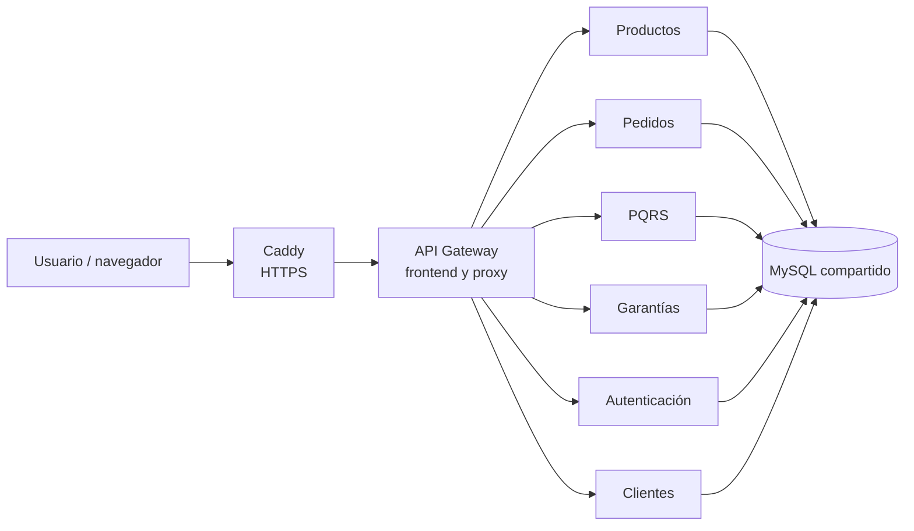

# Novaimport

Novaimport conserva su frontend y sus rutas `/api/...`, con una gateway HTTP y
seis servicios Express independientes:

| Servicio | Prefijo | Puerto interno |
| --- | --- | --- |
| Productos | `/api/productos` | 3001 |
| Pedidos | `/api/pedidos` | 3002 |
| PQRS | `/api/pqrs` | 3003 |
| Garantías | `/api/garantias` | 3004 |
| Autenticación | `/api/auth` | 3005 |
| Clientes | `/api/clientes` | 3006 |
| Gateway | Frontend y proxy API | 3000 |

## Arquitectura de software

Novaimport tiene una **arquitectura distribuida basada en servicios, con estilo
de microservicios**, una API Gateway y despliegue en contenedores. Los servicios
se ejecutan como procesos independientes y cada uno atiende un dominio
funcional. Dentro de cada servicio se separan rutas, controladores,
middleware y configuración.



### Decisiones y límites actuales

- **Comunicación:** el navegador entra por Caddy y la Gateway enruta las
  solicitudes `/api/...` al servicio correspondiente mediante HTTP. Los
  servicios no publican sus puertos al exterior en Compose.
- **Datos:** todos los servicios usan la misma base MySQL y el mismo esquema.
  Es el patrón de **base de datos compartida**: simplifica la operación actual,
  pero acopla los servicios al esquema y no les da autonomía completa sobre los
  datos. Por ejemplo, pedidos descuenta inventario dentro de su transacción.
- **Sesiones y archivos:** las sesiones se guardan en MySQL; imágenes y
  adjuntos usan volúmenes Docker compartidos.
- **Despliegue:** Compose ejecuta gateway y servicios como contenedores
  separados, construidos desde la misma imagen y repositorio.

Por estas decisiones, para una presentación es preciso llamarla **arquitectura
distribuida de servicios con estilo de microservicios y base de datos
compartida**. No es un monolito tradicional, porque los servicios se ejecutan
por separado; tampoco son microservicios plenamente autónomos, principalmente
por compartir esquema, sesiones y archivos. Tener un único repositorio no
determina por sí solo si un sistema es monolítico o de microservicios.

**Ventajas actuales:** separación por dominios, posibilidad de iniciar servicios
por separado y un punto único de entrada. **Costos y limitaciones:** cambios en
el esquema pueden afectar varios servicios, y la base o las sesiones
compartidas pueden convertirse en dependencias comunes. Separar las bases de
datos sería una evolución futura, no un requisito para presentar ni ejecutar el
diseño actual; requeriría rediseñar operaciones que hoy dependen de la
transacción compartida de pedidos e inventario.

Las imágenes y los adjuntos se guardan en volúmenes compartidos de Docker.

## 1. Preparar MySQL

Para una base nueva, importa `shema.sql` en MySQL 8 antes de arrancar la
aplicación. Incluye las tablas y vistas requeridas y el estado `cerrada` de
garantías. No lo importes sobre una base existente.

Para una base existente, primero realiza un backup y revisa su esquema. Si la
columna `garantias.estado` aún no permite el estado `cerrada`, aplica la
migración `migrations/20261028_garantias_estado_cerrada.sql`. La tabla
`sessions` se crea al arrancar los servicios, así que el usuario de MySQL
necesita permiso para crearla. No se requieren permisos de escritura para la
gateway aparte de esa tabla.

## 2. Configurar secretos y destino

`docker-compose.yml` lee las variables de `.env`, que no debe subirse al
repositorio. El `.env.example` sirve como referencia; no contiene credenciales
reales. Configura:

- `DB_HOST`, `DB_PORT`, `DB_USER`, `DB_PASSWORD` y `DB_NAME`.
- `DB_HOST_CONTAINER` si MySQL está fuera del host Docker; por defecto se usa
  `host.docker.internal`, que funciona con Docker Desktop en Windows.
- `DB_TIMEZONE` para interpretar correctamente los `DATETIME`; por defecto es
  `-05:00` (hora de Colombia).
- `EMAIL_USER` y `EMAIL_PASSWORD` para que los servicios de PQR y garantías
  envíen notificaciones. Para Gmail, `EMAIL_PASSWORD` debe ser una contraseña
  de aplicación, no la contraseña normal de la cuenta.
- Los formularios de PQR y garantías solicitan un correo electrónico válido,
  ya que las respuestas del administrador se notifican por correo.
- `SESSION_SECRET` con al menos 32 caracteres aleatorios.
- `ADMIN_USER` y `ADMIN_PASSWORD` para el súper-administrador; Compose los
  entrega únicamente al servicio de autenticación.
- `SITE_HOST` con el dominio público una vez que esté disponible. Por ahora se
  puede usar `localhost`.

La clave de sesión local fue rotada. Eso invalida las sesiones existentes.
Rota también las credenciales de base de datos o correo si sospechas que se
expusieron; no las compartas ni las añadas al repositorio.

## 3. HTTPS y ejecución con Docker

Caddy termina HTTPS y envía el tráfico al gateway; el gateway es el único
servicio de la aplicación accesible a través del proxy. Para desarrollo,
`SITE_HOST=localhost` permite abrir `https://localhost`, aunque el certificado
local de Caddy puede requerir confiar en la autoridad certificadora local.

Para producción, configura `SITE_HOST` con un dominio cuyo DNS apunte al
servidor y permite tráfico entrante por los puertos 80 y 443. Caddy obtendrá y
renovará el certificado público automáticamente.

Con Docker Desktop iniciado:

```sh
docker compose config --quiet
docker compose up --build
```

La web queda disponible en `https://localhost` para configuración local. Si el
navegador no confía en la autoridad certificadora local de Caddy, usa
`http://localhost:3000`; este acceso directo al gateway está limitado a
`127.0.0.1` y no publica los puertos internos de los servicios en la red.

## 4. Pruebas

Las pruebas automatizadas de gateway no necesitan Docker ni conectarse a MySQL:

```sh
npm test
```

Verifican el proxy API, métodos, rutas, query string, cuerpo, cookies, frontend,
protección del panel y health check. No hay pruebas de integración automatizadas
que ejerciten los seis servicios contra MySQL. Para validar el flujo completo,
se necesitan Docker Desktop, la base inicializada y permiso para crear
la tabla compartida de sesiones. No ejecutes pruebas que escriban en una base
de producción.

## 5. Ejecutar servicios localmente

Sin Docker, `npm start` inicia la gateway y cada servicio se ejecuta en una
terminal separada:

```sh
npm run start:service -- productos
npm run start:service -- pedidos
npm run start:service -- pqrs
npm run start:service -- garantias
npm run start:service -- auth
npm run start:service -- clientes
```

Se pueden cambiar los destinos de la gateway usando `PRODUCTOS_SERVICE_URL`,
`PEDIDOS_SERVICE_URL`, `PQRS_SERVICE_URL`, `GARANTIAS_SERVICE_URL`,
`AUTH_SERVICE_URL` y `CLIENTES_SERVICE_URL`.
